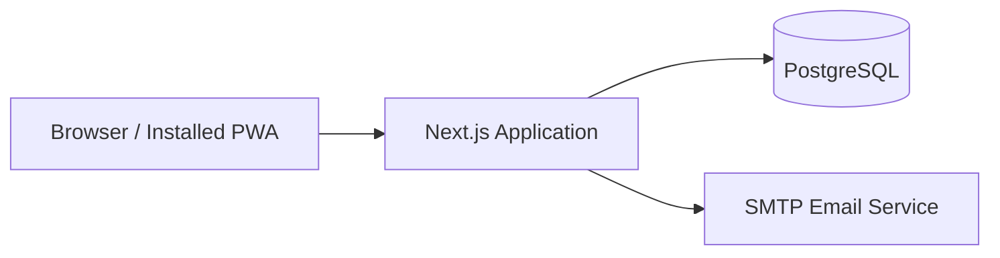

# Carely

## Open-Source, Self-Hostable Hospital Management System

Carely is an open-source Hospital Management System designed for small and medium-sized healthcare institutions, particularly hospitals that still depend on paper-based or fragmented digital workflows.

The course release is delivered as a single installable **Next.js Progressive Web Application (PWA)** for both patients and hospital staff. Each hospital operates an independent Carely deployment with its own authentication configuration and PostgreSQL database.

Hospital is the project's pilot client and design partner.

> Carely is an academic prototype. It is not production-certified medical software and must not be used as a substitute for professional clinical judgement.

---

## Current Scope

This repository represents the scope committed for the university course project. The priority is a complete, reliable and demonstrable hospital workflow rather than a large collection of partially implemented features.

The system includes:

- One web application for patients and hospital staff
- Patient registration and account access
- Doctor discovery and appointment booking
- Consultation queue management
- Nurse intake and vital-sign recording
- Doctor-authored clinical notes
- Structured prescriptions
- Basic pharmacy inventory and dispensing
- Staff, role and configuration management
- Important audit records
- Docker-based self-hosted deployment

---

## User Roles

Carely supports six primary user roles.

| Role             | Main responsibilities                                                                                                              |
| ---------------- | ---------------------------------------------------------------------------------------------------------------------------------- |
| **Patient**      | Register, verify an email address, sign in, find a doctor, book and view appointments, view queue position, and view prescriptions |
| **Receptionist** | Search or register patients, create appointments, handle walk-ins, check patients into queues, and update queue status             |
| **Nurse**        | View the intake queue, record vital signs, initial complaints and preliminary notes                                                |
| **Doctor**       | Manage availability, review assigned patients, record clinical notes, create prescriptions and complete consultations              |
| **Pharmacist**   | View issued prescriptions, dispense complete prescriptions, maintain medicine stock and prevent over-dispensing                    |
| **System Admin** | Manage staff accounts, roles, specialties, doctor-finder mappings, hospital settings and audit records                             |

---

## Core Features

### Authentication and Access

- Email-and-password authentication using Better Auth
- Patient email verification
- Password recovery through email
- Secure session-based authentication
- Server-side role-based access control
- Staff-account deactivation
- Protected server actions and Route Handlers

Staff accounts are created by an administrator. Public staff registration is not supported.

### Patient Management

- Patient self-registration
- Staff-assisted patient registration
- System-generated patient ID
- Patient search by ID, name or phone number
- Patient profile management
- No government identity-document collection in the committed release

### Doctor Finder

- Predefined reasons for visiting the hospital
- Deterministic mapping from reasons to medical specialties
- Matching active doctors based on specialty and availability
- No AI-based symptom analysis or diagnosis

### Appointments

- Doctor availability management
- Available appointment slots
- Patient appointment booking
- Receptionist-assisted booking
- Walk-in appointment creation
- Appointment viewing

### Queue Management

- Patient check-in
- Queue entry and ordering
- Queue-status updates
- Patient-visible queue position
- Timed polling while the queue page is active

Queue updates use the browser's native `fetch` API through a small custom React hook. A separate real-time service is not required.

### Nurse Intake

- Intake-queue access
- Vital-sign recording
- Initial complaint recording
- Preliminary notes
- Intake completion and consultation handoff

### Clinical Records

- Doctor-authored clinical notes
- Allergies and relevant clinical information
- Visit records with author and timestamp
- No generated summaries or automated clinical recommendations

### Prescriptions

- Structured prescriptions created manually by doctors
- Medicine, dosage and instruction recording
- Patient prescription viewing
- No automated dosage or medicine recommendations

### Pharmacy and Inventory

- Medicine catalogue
- Current stock quantities
- Prescription viewing
- Complete prescription dispensing
- Duplicate-dispensing prevention
- Atomic stock reduction

Partial dispensing, batch tracking, expiry workflows and stock-request workflows are outside the course release.

### Administration and Auditing

- Staff-account management
- Role assignment and account deactivation
- Specialty management
- Doctor-finder configuration
- Basic hospital settings
- Review of important audit events

---

## Application Architecture

Carely is implemented as one Next.js application containing the patient interface, staff interfaces, Route Handlers, authentication integration and server-side business logic.



The nurse UI structure, planned data integration, and temporary provider removal conditions are documented in [Nurse architecture](docs/nurse-architecture.md).

The updated admin UI structure and demo-data limitations are documented in [Admin UI](docs/admin-ui.md).

The pharmacist and receptionist UI workflows and temporary demo-state removal conditions are documented in [Pharmacy and reception UI](docs/pharmacy-reception-ui.md).

The patient UI structure, demo workflows, and planned removal of temporary booking state are documented in [Patient UI](docs/patient-ui.md).

### Request Flow

```text
User interface
    ↓
Server Action or Route Handler
    ↓
Authentication, authorization and validation
    ↓
Application logic
    ↓
Drizzle ORM
    ↓
PostgreSQL
```

Business rules and authorization must remain on the server. Hiding an action in the interface is not considered a security control.

---

## Technology Stack

| Area                   | Technology                                |
| ---------------------- | ----------------------------------------- |
| Full-stack application | Next.js 16 with App Router                |
| Language               | TypeScript                                |
| Styling                | Tailwind CSS                              |
| UI components          | shadcn/ui                                 |
| Forms                  | React Hook Form                           |
| Icons                  | Lucide                                    |
| Authentication         | Better Auth                               |
| Authorization          | Server-side role-based access control     |
| Validation             | Zod                                       |
| Database               | PostgreSQL                                |
| ORM                    | Drizzle ORM                               |
| Email                  | Nodemailer with configurable SMTP         |
| Queue refresh          | Native `fetch` with a custom polling hook |
| Package manager        | pnpm                                      |
| Deployment             | Docker and Docker Compose                 |
| UI/UX design           | Figma                                     |

Gmail SMTP is used only as the pilot email provider. Carely keeps SMTP settings configurable so another provider can be used by a hospital.

---

## Database Portability

Carely connects to PostgreSQL using a standard `DATABASE_URL`.

- Local PostgreSQL can be used during development.
- Supabase PostgreSQL is used for the demonstration deployment.
- A hospital can use another compatible local or managed PostgreSQL service.
- Core application logic must not depend on Supabase-specific APIs.

Each hospital deployment uses an independent database and authentication context. Carely does not provide shared patient accounts or clinical records across hospitals.

---

## Patient and Staff Access

Each hospital provides its own Carely URL through its website, reception desk or a QR code.

Example routes may include:

```text
/                         Redirects to the shared sign-in page
/login                    Shared patient and staff sign-in
/signup                   Patient registration
/forgot-password          Password recovery
/patient/*                 Protected patient pages
/doctor/*                  Protected doctor pages
/nurse/*                   Protected nurse pages
/reception/*               Protected receptionist pages
/pharmacy/*                Protected pharmacist pages
/admin/*                   Protected administration pages
```

After authentication, the server redirects the user to the correct workspace according to the assigned role. Every protected operation verifies the session and role again on the server.

---

## Email Flows

Carely uses Nodemailer with a configurable SMTP server for:

- Patient email verification
- Password-reset links

Login OTP and social login are not included in the course release.

---

## Self-Hosting

Each hospital can deploy an independent Carely instance.

```text
Hospital Carely Instance
├── Next.js application
├── PostgreSQL connection
├── Better Auth configuration
└── SMTP configuration
```

Docker and Docker Compose provide a repeatable reference deployment. Provider-specific credentials and connection details are supplied through environment variables.

Carely does not require Vercel, Supabase or Gmail to operate. They may be used for the demonstration, but they are not mandatory platform dependencies.

---

## Environment Variables

Create a local environment file based on the repository's example configuration.

```env
DATABASE_URL=

BETTER_AUTH_SECRET=
BETTER_AUTH_URL=

SMTP_HOST=
SMTP_PORT=
SMTP_USER=
SMTP_PASS=
SMTP_FROM=
```

Environment files and production secrets must never be committed to Git.

---

## Local Development

### Requirements

- Node.js 22 or later
- pnpm
- PostgreSQL

### Install dependencies

```bash
corepack enable
pnpm install
```

### Configure the environment

Copy the example environment file and provide the required values.

```bash
cp .env.example .env.local
```

### Run database migrations

```bash
pnpm db:migrate
```

### Start the development server

```bash
pnpm dev
```

Open [http://localhost:3000](http://localhost:3000).

The exact script names should follow the root `package.json` if they differ from the examples above.

---

## Docker Deployment

Build and start the reference deployment with:

```bash
docker compose up --build
```

Stop it with:

```bash
docker compose down
```

Production deployments must use strong secrets, HTTPS and a protected PostgreSQL connection.

---

## Security Principles

Carely handles sensitive healthcare information, so security is part of the core design.

- Enforce authentication and role authorization on the server
- Validate all untrusted input with Zod
- Use secure, HTTP-only session cookies
- Apply the principle of least privilege
- Keep hospital deployments and databases isolated
- Record important administrative and clinical changes
- Protect secrets through environment configuration
- Use HTTPS outside local development
- Avoid collecting unnecessary personal identifiers
- Never rely only on client-side permission checks

---

## Project Status

Carely is under active development for the EEI4189 Software Design in Group course. The current scope is intentionally limited so the team can deliver and test one complete end-to-end hospital workflow within the available timeline.

The wider Carely vision may continue after the course project, but future ideas are not treated as committed requirements for this release.

---

## Academic Context

Carely is a university software-engineering project developed with Hospital as the pilot client and design partner. It demonstrates requirements analysis, user-interface design, access control, relational data modelling, full-stack development, testing and self-hosted deployment.

---

## License

The licence is to be finalized. Carely is intended to be released as an open-source project.
