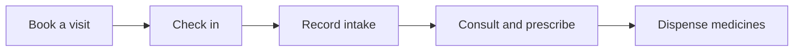

<!-- markdownlint-disable MD033 MD041 -->

<div align="center">

# Carely

**Self-hosted hospital management for patients and care teams.**

[![Next.js 16][badge-next]][nextjs]
[![TypeScript 5][badge-ts]][typescript]
[![PostgreSQL database][badge-db]][postgresql]
[![Better Auth][badge-auth]][better-auth]
[![Docker Compose][badge-docker]](docs/deployment.md)

[Workflows](#workflows) · [Getting started](#getting-started) ·
[Self-hosting](#self-hosting) · [Documentation](#documentation)

</div>

<!-- markdownlint-enable MD033 MD041 -->

---

Carely brings appointment booking, reception check-in, nursing intake, consultations, and pharmacy dispensing into one web application. It is designed for small and medium-sized hospitals. Each hospital runs its own instance with its own PostgreSQL database, authentication configuration, and SMTP settings.

> [!NOTE]
> Carely is an academic prototype for the EEI4189 Software Design in Group course. Use synthetic records for demos and verification.

## Workflows



| Workspace     | What you can do                                                                                                                         |
| ------------- | --------------------------------------------------------------------------------------------------------------------------------------- |
| **Patient**   | Verify your email, find a doctor by reason for visit, book or cancel an appointment, track your queue position, and view prescriptions. |
| **Reception** | Find patients, register walk-ins, book on their behalf, check in arrivals, and view the live queue.                                     |
| **Nurse**     | Record vital signs, initial complaints, and preliminary notes, then hand off the patient to the doctor.                                 |
| **Doctor**    | Set weekly availability, review patients in your care, write clinical notes, prescribe medicines, and complete visits.                  |
| **Pharmacy**  | Manage the medicine catalogue and stock batches, review prescriptions, and dispense from eligible stock.                                |
| **Admin**     | Invite and manage staff, configure specialties and visit reasons, update hospital details, and review audit events.                     |

Browse the [workflow and API reference](docs/workflows.md) for route details, queue states, and access rules.

## Getting started

Use **Node.js 24**, **pnpm 11.20.0**, and a PostgreSQL database. Configure an SMTP service for patient verification, password recovery, and staff invitations.

### Install and configure

```bash
pnpm install --frozen-lockfile
cp .env.example .env.local
```

Set these values in `.env.local`. See [`.env.example`](.env.example) for the available settings.

| Settings                                    | Purpose                                                                                   |
| ------------------------------------------- | ----------------------------------------------------------------------------------------- |
| `DATABASE_URL`                              | Connection to your Carely PostgreSQL database.                                            |
| `BETTER_AUTH_SECRET`                        | A random session secret.                                                                  |
| `BETTER_AUTH_URL` and `NEXT_PUBLIC_APP_URL` | The browser-facing origin, usually `http://localhost:3000` for local development.         |
| `SMTP_*`                                    | Connection and sender settings for your mail service.                                     |
| `ADMIN_EMAIL` and `ADMIN_PASSWORD`          | Credentials for the first administrator. Use a unique password of at least 12 characters. |

### Initialize and run

```bash
pnpm db:migrate
pnpm seed:admin
pnpm dev
```

Open [localhost:3000](http://localhost:3000) and sign in with the administrator account you seeded. Staff join by invitation. Patients can create an account on `/signup`.

## Self-hosting

Docker Compose defines the app, PostgreSQL, a migration job, and Mailpit for local demo email.

```bash
cp .env.docker.example .env.docker
```

Set the database password, Better Auth secret, public URL, and administrator credentials in `.env.docker`, then start the stack.

```bash
docker compose --env-file .env.docker up -d --build app
docker compose --env-file .env.docker --profile tools run --rm seed-admin
```

The app is available at [localhost:3000](http://localhost:3000) by default. Follow the [deployment runbook](docs/deployment.md) for HTTPS, the Next.js security note, and the fresh-install checklist. Use the [backup and restore runbook](docs/backup-restore.md) to rehearse recovery in a separate database.

## Project structure

```text
app/          Next.js pages and API routes
components/   Shared UI and role-specific screens
lib/          Authentication, validation, business rules, and database schemas
drizzle/      PostgreSQL migrations
templates/    Verification, recovery, and invitation emails
tests/        Focused automated tests
docs/         Workflows, deployment, backup, and testing guides
```

The application uses the Next.js App Router, React, Tailwind CSS, Better Auth, Drizzle ORM, and Zod. Role checks and record-level authorization run on the server. Booking, intake, and dispensing use PostgreSQL transactions, and important writes record audit events.

## Testing

```bash
pnpm test
pnpm lint
pnpm build
```

The retained unit suite runs without PostgreSQL or SMTP. See the [testing guide](docs/testing.md) for coverage and the [release walkthrough](docs/workflows.md#manual-release-walkthrough) for the six-role manual check.

## Documentation

| Guide                                        | Covers                                                          |
| -------------------------------------------- | --------------------------------------------------------------- |
| [Workflows and APIs](docs/workflows.md)      | Roles, routes, business rules, and the release walkthrough.     |
| [Deployment](docs/deployment.md)             | Environment setup, Docker Compose, and fresh-install checks.    |
| [Backup and restore](docs/backup-restore.md) | Backing up PostgreSQL and verifying a restore.                  |
| [Testing](docs/testing.md)                   | Current test commands and coverage.                             |
| [Audit contract](lib/audit/README.md)        | Transaction requirements, event metadata, and retention checks. |

## License

The project is intended for open-source release. Licensing is pending.

[badge-next]: https://img.shields.io/badge/Next.js-16-000000?style=for-the-badge&labelColor=171717&logo=nextdotjs&logoColor=white
[badge-ts]: https://img.shields.io/badge/TypeScript-5-3178c6?style=for-the-badge&labelColor=235a97&logo=typescript&logoColor=white
[badge-db]: https://img.shields.io/badge/Database-PostgreSQL-336791?style=for-the-badge&labelColor=244960&logo=postgresql&logoColor=white
[badge-auth]: https://img.shields.io/badge/Auth-Better%20Auth-27272a?style=for-the-badge&labelColor=18181b&logo=betterauth&logoColor=white
[badge-docker]: https://img.shields.io/badge/Docker-Compose-1d63ed?style=for-the-badge&labelColor=1547ac&logo=docker&logoColor=white
[nextjs]: https://nextjs.org/
[typescript]: https://www.typescriptlang.org/
[postgresql]: https://www.postgresql.org/
[better-auth]: https://www.better-auth.com/
