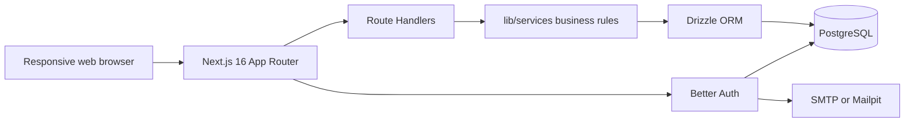
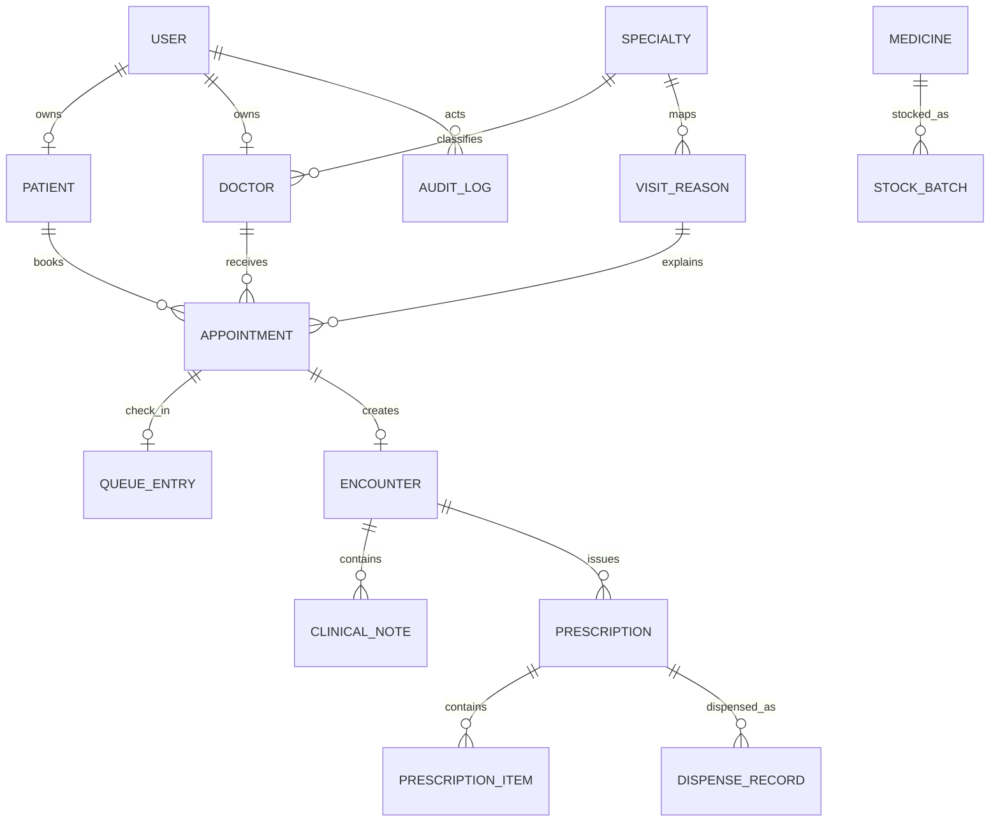

# Carely architecture

This is the current web-only architecture. Historical foundation documents describe
earlier branches and should not be used as the current component inventory.



## Request and mutation flow

```mermaid
sequenceDiagram
  participant UI as Client or server UI
  participant Route as Route Handler
  participant Guard as requireRole
  participant Service as Service transaction
  participant DB as PostgreSQL

  UI->>Route: validated request fields
  Route->>Guard: session and role
  Guard-->>Route: server-derived actor
  Route->>Service: actor plus parsed input
  Service->>DB: begin; policy/locks/write
  Service->>DB: insert audit_log
  DB-->>Service: commit or rollback together
  Service-->>Route: result/service error
  Route-->>UI: JSON status and no-store where required
```

## Layer responsibilities

| Layer                 | Responsibility                                                |
| --------------------- | ------------------------------------------------------------- |
| `app/(authenticated)` | Role workspaces and server-rendered entry pages               |
| `components`          | Interactive forms, polling, loading/error/empty feedback      |
| `app/api`             | Authentication boundary, parsing and HTTP mapping             |
| `lib/schemas`         | Zod request/response contracts                                |
| `lib/services`        | Authorization policy, business rules, transactions and locks  |
| `lib/db/schema`       | Drizzle mapping of PostgreSQL tables                          |
| `lib/audit/actions`   | Per-feature action names                                      |
| `drizzle`             | Ordered migrations, constraints and append-only audit trigger |

## Main data relationships



## Security and privacy boundaries

- The browser never supplies a trusted actor or target patient identity.
- Role checks occur at routes and active-account/record checks occur in services.
- Patient/clinical record denial uses 404 where existence must not be leaked.
- Audit metadata accepts structural data, not patient values or clinical text.
- Audit rows are read-only through the application and protected by a database trigger.
- Clinic dates and “today” use Asia/Colombo.

## Deployment boundary

Docker Compose definitions exist for Next.js, PostgreSQL, migration, Mailpit and
admin seeding. They have not been runtime-verified under the recovery plan. See
[installation](installation.md), [deployment](deployment.md) and
[backup/restore](backup-restore.md).
