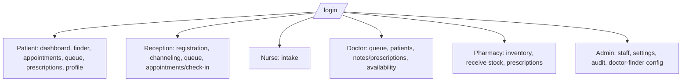

# UI figures and route map

These repository-native figures document navigation and workflow without claiming
that a screenshot walkthrough passed. Actual screenshots should be captured only
from the final merged build and added with date/revision captions.

## Six-role navigation

## Hospital journey screen flow

```mermaid
flowchart LR
  Register[Patient signup or reception registration]
  Find[Patient reason-based finder]
  Book[Appointment confirmation]
  CheckIn[Reception check-in]
  Intake[Nurse intake]
  Consult[Doctor open + note + prescription]
  Complete[Doctor complete]
  Dispense[Pharmacist dispense]
  Audit[Admin audit review]

  Register --> Find --> Book --> CheckIn --> Intake --> Consult --> Complete --> Dispense --> Audit
```

## Screenshot checklist

Capture only after the final merged manual run:

1. Patient reason selection, matched doctor and saved appointment.
2. Reception check-in and queue entry.
3. Nurse intake form and saved confirmation without clinical values exposed in evidence.
4. Doctor active consultation, saved note and mixed prescription.
5. Pharmacy eligibility and completed dispense.
6. Admin settings/reason mapping and filtered audit page.

Use synthetic identities. Blur or exclude secrets, email tokens and clinical values.
No screenshots are currently included or claimed as verified by this file.
